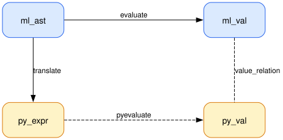

# rocq-python-plugin

Rocq から Python への Extraction をできるようにする。

## How to use

### インストール

```console
opam pin add rocq-pycert git+https://github.com/proof-ninja/PyCert.git
opam pin add rocq-python-plugin git+https://github.com/proof-ninja/rocq-python-plugin.git
```

(rocq-core.9.4以上が必要です)

### Rocq から Python を生成する

```rocq
From PythonPlugin Require Import Python.
From Stdlib Require Import List.
Extraction Language Python.

Extraction "sample.py" List.map.
```

`rocq c Sample.v` で `sample.py` ができる。


### 生成した Python を使う

```python
import sample

zero = ("O",)
succ = lambda n: ("S", n)
xs = ("Cons", zero, ("Cons", succ(zero), ("Nil",)))   # [0; 1]

print(sample.g_map(succ)(xs))   # [1; 2] = ("Cons", ("S", ("O",)), ("Cons", ("S", ("S", ("O",))), ("Nil",)))
```

### TODO

- [ ] float、primitive string、primitive array
- [ ] `Extract Inductive` による名前の置き換え
- [ ] `Extraction Library` (複数ファイルへの抽出)

## 証明事項

Rocq のプログラム (Extraction が出す MiniML) を Python に変換しても、意味が変わらない。

```rocq
Theorem translate_correct py_env ml_globals ml_expr v :
  evaluate (init_env ml_globals) ml_expr (Ok v) ->
  globals_relation ml_globals py_env ->
  exists pv, pyevaluate py_env (translate ml_expr) (Ok pv) /\ value_relation v pv.
```

MiniML の式 `ml_expr` が、グローバル環境 `ml_globals` だけの環境 (`init_env ml_globals`) のもとで値 `v` に
評価される (`Ok v`) なら、`ml_expr` を翻訳した Python の式を、対応する Python の環境 `py_env` で評価すると、
`v` に対応する値 `pv` になる。



### TODO

- [ ] `translate_correct` の証明
- [ ] `translate_program_correct` / `_error` の証明と、前提 `well_formed_program` の定義 (現在は `Parameter`)
- [ ] 発散と Python の再帰上限の扱い (今は評価が成功する場合のみ)
